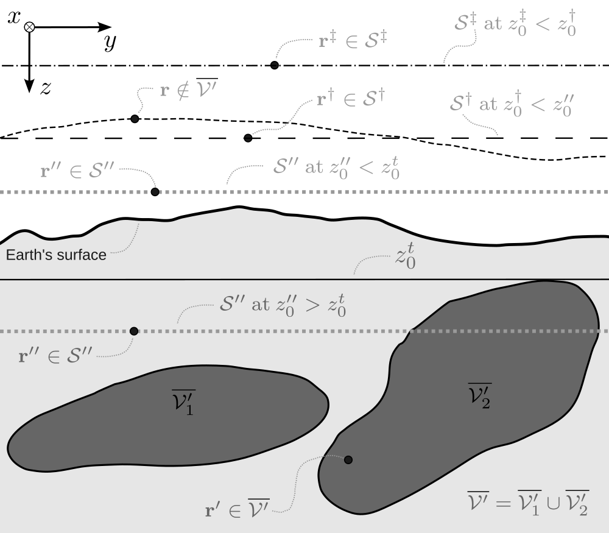

# Potential-field theoretical insights on planar equivalent layers

by Vanderlei C. Oliveira Jr1, 
Christian Gerhards2, 
Valéria C. F. Barbosa1, 
André L. A. Reis1, 3, 
Edson F. Luza1 and 
Xinpeng Huang2

1 Observatório Nacional, Rio de Janeiro, Brazil

2 TU Bergakademie Freiberg, Institute of Geophysics and Geoinformatics

3 Universidade do Estado do Rio de Janeiro, Rio de Janeiro, Brazil

*2D schematic representation of sources located in subsurface and the geometrical aspects of our work.*

## Abstract

We present a comprehensive theoretical framework for potential-field transformations using planar equivalent layers, a technique empirically developed since the 1960s in applied geophysics. We aim to replace the widely accepted equivalent-layer principle – primarily based on empirical generalizations – with a more rigorous theoretical foundation. We introduce and mathematically prove the *planar equivalent-layer theorem*, which establishes the existence of continuous planar layers that can accurately reproduce potential-field data within a predefined error level, even for layers that cross the true sources. We present closed-form expressions for planar equivalent layers by modifying the solutions of Dirichlet’s and Neumann’s problems and demonstrate that planar equivalent layers are not merely mathematical constructs, but have tangible physical significance related to boundary value problems in potential theory. Using our closed-form expressions, we mathematically show the equivalence between potential-field transformations made via equivalent-layer technique and those commonly derived from the Fourier transform of observed potential-field data. Moreover, we define different classes of equivalent layers and their relationships with the observed potential-field data, true sources and the desired potential-field transformation. Our work advances the understanding of why the equivalent-layer technique has been effectively applied in potential-field transformations.

## Numerical simulations

All source code used to generate the results and figures in the paper are in the `code` folder.
The calculations and figure generation are all run inside [Jupyter notebooks](http://jupyter.org/).

## Getting the manuscript and all numerical simulations

You can download a copy of all the files in this repository by cloning the repository:

    git clone https://github.com/birocoles/planar-eqlayer-theory.git

or [download a zip archive](https://github.com/birocoles/planar-eqlayer-theory/XXXXXX/main.zip).

A copy of the repository is also archived at *insert DOI here*

## Dependencies

You'll need a working Python environment to run the code.
The recommended way to set up your environment is through the
[Anaconda Python distribution](https://www.anaconda.com/download/) which
provides the `conda` package manager.
Anaconda can be installed in your user directory and does not interfere with
the system Python installation.
The required dependencies are specified in the file `environment.yml`.

We use `conda` virtual environments to manage the project dependencies in
isolation.
Thus, you can install our dependencies without causing conflicts with your
setup (even with different Python versions).

Run the following command in the repository folder (where `environment.yml`
is located) to create a separate environment and install all required
dependencies in it:

    conda env create

## Reproducing the results

Before running any code you must activate the conda environment:

    source activate ENVIRONMENT_NAME

or, if you're on Windows:

    activate ENVIRONMENT_NAME

This will enable the environment for your current terminal session.
Any subsequent commands will use software that is installed in the environment.

To build and test the software, produce all results and figures, and compile
the manuscript PDF, run this in the top level of the repository:

    make all

If all goes well, the manuscript PDF will be placed in `manuscript/output`.

You can also run individual steps in the process using the `Makefile`s from the
`code` and `manuscript` folders. See the respective `README.md` files for
instructions.

Another way of exploring the code results is to execute the Jupyter notebooks
individually.
To do this, you must first start the notebook server by going into the
repository top level and running:

    jupyter notebook

This will start the server and open your default web browser to the Jupyter
interface. In the page, go into the `code/notebooks` folder and select the
notebook that you wish to view/run.

The notebook is divided into cells (some have text while other have code).
Each cell can be executed using `Shift + Enter`.
Executing text cells does nothing and executing code cells runs the code
and produces it's output.
To execute the whole notebook, run all cells in order.

## License

All source code is made available under a BSD 3-clause license. You can freely
use and modify the code, without warranty, so long as you provide attribution
to the authors. See `LICENSE.md` for the full license text.

The manuscript text is not open source. The authors reserve the rights to the
article content, which is currently submitted for publication in the
GEOPHYSICS.
